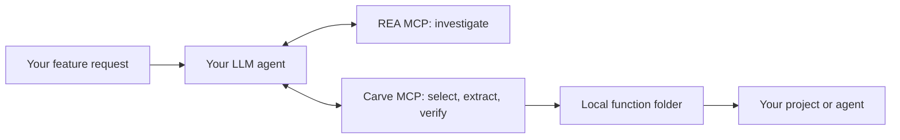

# Carve

**Turn investigated software behavior into reusable local functions.**

Carve is an independent companion MCP for [REA](https://github.com/morluto/rea). Your LLM calls **REA MCP** to investigate software, and **Carve MCP** to choose a feature, define its boundary, extract or rebuild it, compare behavior, and save a reusable function folder. The two servers keep their own tools and processes.

**0.38.1 local alpha · Not published to npm.** [繁體中文](README.zh-TW.md) · [Two-MCP setup and clean-install test](docs/REA_COMPANION.md)

## Why Carve

A useful feature may be buried in an application, depend on several modules, or look deceptively similar to another implementation. Carve helps the agent turn that investigation into a concrete deliverable:

- **Choose with evidence.** Show likely features with source-linked leads. Accept a custom description when none fit.
- **Keep the boundary explicit.** Bind selected code and supporting evidence, identify dependencies, and retain unknown server or platform behavior.
- **Check the result.** Compare named cases against the original operation or an explicitly scoped reference. Ambiguity and failures remain visible.
- **Reuse the function.** Store code, provenance, recorded comparisons and a SKILL.md in a local folder. The next agent finds it and imports or invokes it.



The LLM coordinates two independent MCP connections. Carve MCP does not start, wrap or proxy REA, and this workflow introduces no combined MCP server. Existing Carve Ghidra/JADX helpers remain available for compatibility; they do not embed REA.

## Connect the two MCPs

Requires Node22.19 in the22 line, or Node24.11+. In this Carve source directory:

```sh
npm ci
npm run build
```

Keep two entries in your agent's MCP configuration, replacing the absolute paths:

```json
{
  "mcpServers": {
    "rea": {
      "command": "npx",
      "args": ["-y", "rea-agents@6.7.0", "mcp"]
    },
    "carve": {
      "command": "node",
      "args": ["/absolute/path/to/carve/dist/cli.js", "serve", "--root", "/absolute/path/to/workspace"]
    }
  }
}
```

REA is installed separately. Carve is built locally. The root must contain the inputs, Evidence JSON and outputs that Carve needs. No website, API service, per-function installation or global configuration change is required by Carve. See the [complete setup and tested handoff](docs/REA_COMPANION.md).

## Ask your agent

> Use REA to investigate this application and Carve to show likely reusable features. Show the evidence and unresolved dependencies. If none of the choices fit, let me describe my own feature. Once I choose, extract or reconstruct that bounded behavior, compare concrete examples, and save a function folder I can reuse.

For a known feature, name its trigger, input and desired output. The agent still needs to inspect actual code and dependency boundaries.

From the CLI, start without knowing internal function names:

```sh
node dist/cli.js reverse /path/to/software --out ./work
node dist/cli.js features ./work
node dist/cli.js features ./work --choice image --facet transform
```

`reverse` returns `awaiting-feature-choice` when the input inventory is complete and no goal was supplied. Choose a suggestion or describe another feature, then repeat reverse with `--goal` to create its stable task. The [feature menu](docs/FEATURE_MENU.md) uses bounded recorded-name/path rules, not an embedded LLM or a guarantee of extractability. Partial inventory and scan pages remain explicit.

After choosing image processing, narrow it to transforms, loading or caching. The agent uses `carve_scope` to save the trigger, input/output, state lifetime and UI/remote/host requirements. Missing answers remain questions; a later session resumes by record ID. These are intent and source leads; complete code, dependencies and behavior still need investigation. [Clarification and resumption](docs/FEATURE_SCOPE.md)

Choose the destination independently of the source: Windows modules, Mac apps, browser modules or services. Optional scope target records intent with targetAssessment:not-performed. For a whole project, project-plan / carve_project_plan orders an agent-authored dependency graph and exposes cycles; it does not discover all features, dispatch agents or assemble an app. [Destination schema](docs/FEATURE_SCOPE.md#output-target) · [Project planning](docs/PROJECT_PLAN.md)

Prepare selected tasks with complete input/output/state/error interface pins, declared editable files and acceptance criteria. Use `work-package create PLAN SPEC --feature parser --out NEW_FOLDER`, then `work-package check FOLDER --plan PLAN --spec SPEC` before an agent adopts it. Existing agents do the work; Carve prepares and checks the handoff. [Work packages and runnable example](docs/WORK_PACKAGES.md)

Coordinate existing workers with `work-ledger`: atomic claims, persistent attempts, explicit retries, proposal/implementation handoffs and review requeue. Old attempts and changed interfaces cannot submit new work. Checks stay agent-reported until independently verified. [Task coordination](docs/WORK_LEDGER.md)

For indexed Windows PE inputs, `platform dependencies` / `platform adapters` and `carve_platform` expose source import categories and target adapter guidance. They identify investigation needs; they do not implement or validate a port. [Platform analysis](docs/PLATFORM_ANALYSIS.md)

## What you get

| Input and boundary | Deliverable |
| --- | --- |
| Supported JavaScript / ASAR declaration closure | Extracted function with its required source dependencies |
| Selected compiled behavior with complete code evidence | Agent-authored reconstruction plus provenance and scoped comparisons |
| Checked package | Local function folder with index.mjs, metadata, SKILL.md and recorded verification |
| Missing server, hardware or unresolved dependency | An explicit unknown or incomplete boundary |

Store a checked package with `carve_library_add`. Later use `carve_library_find`, `carve_library_get`, then import `index.mjs` or call `carve_invoke`. These folders need no standalone program. [Function library](docs/LIBRARY.md)

For compatible REA JS/ASAR Evidence, save the actual response as JSON and pass it to Carve for module/artifact byte binding. For the supported native Ghidra profile, save matching complete procedure_pseudo_code and procedure_info Evidence and call carve_import_rea_native. Carve checks source bytes, canonical record/profile commitments and body metadata, then retains owned snapshots and original producer IDs. Optional procedure_callees and outgoing procedure_references preserve typed call sites, missing helper code and unresolved callbacks; trace/context follow only matching REA analysis profiles. No REA process is started by Carve MCP. [Native handoff](docs/REA_NATIVE.md) · [JS handoff](docs/REA_COMPANION.md)

## Concrete checks

- **Independent REA native handoff:** real REA/Ghidra code and function records imported after REA closes;160direct original native CLI comparisons, exact producer identities and library-only reuse. The relationship case adds two helpers, three bound code records and160original CLI comparisons; unresolved callback and external thunk targets stay explicit. Recorded static edges do not establish dependency closure. [Reproduce it](docs/REA_NATIVE.md)
- **REA cross-image bridge:** original direct-call instruction, symbol stub/library ordinal, local load path and defined export bind two separately analyzed functions;162original CLI cases and function-folder reuse, with a same-name decoy rejected. Runtime/ABI/environment closure remains unknown. [Cross-image workflow](docs/REA_BRIDGE.md)
- **Separate analysis workspaces:** caller and library retain independent indexes and REA snapshots. Cross-workspace bridges rebind both sources and require declared/authorized endpoints; sibling workspace relocation preserves immutable relative commitments. A fresh independent REA check compares162original CLI cases and rejects a same-name wrong-path library. [Workflow and limits](docs/REA_BRIDGE.md#cross-workspace-handoff)
- **Stateful sequences**: one original process and one candidate module instance per ordered sequence;32 source-owned native sequences /635 steps compared, including add/set/undo and a reset-per-call counterexample. Whole sequence examples survive function-folder reuse. Separate requests start fresh. [Protocol and reproduction](docs/STATEFUL.md)
- **Third-party stateful operation**:31 sequences /405 steps against the shipped JDK Adler32 object, combining complete Java class evidence with independent REA native code. Initialization, chunks, empty updates and reset survive function-folder reuse. The runtime class hash matches the analyzed module-image bytes; the invocation adapter remains explicitly scoped. [Evidence and reproduction](docs/JDK_STATEFUL.md)
- **Original Android object state**:33 sequences /692 steps against the shipped ZXing APK BitArray on Android15/API35 ARM64 ART. Clear preserves length, new explicitly constructs a fresh object, and per-call reset is rejected. Original DEX is retained; the independent function folder works through direct import, CLI and two fresh MCP requests. Uses the existing managed backend, without starting or proxying REA. [Boundary and reproduction](docs/ZXING_STATEFUL.md)
- **Actual Android JNI:** shipped Termux DEX → native getZip on ART →80metadata query comparisons covering3490ZIP entries; reusable metadata-only catalog. [Scope and report](docs/TERMUX_BOOTSTRAP.md)
- **Cross-component reconstruction:** owned stripped executable and library,162original CLI cases, independent reuse. [Multi-artifact evidence](docs/MULTI_ARTIFACT.md)

## Develop and validate

```sh
npm test
npm run verify:project-intent
npm run verify:feature-scope
npm run verify:rea-native -- --engines ./artifacts/engines/config.json
npm run verify:rea-relationships -- --engines ./artifacts/engines/config.json
npm run verify:rea-bridge -- --engines ./artifacts/engines/config.json
npm run check
```

The native REA checks install a pinned package in a new artifacts directory by default and run independent REA and Carve processes. They exercise selected source-owned native boundaries, not every REA provider. Other checks: [native tracing](docs/NATIVE.md), [Android](docs/ANDROID.md), [JNI](docs/JNI.md), [large analysis budgets](docs/ENGINE_RESOURCES.md), [resumable queue](docs/QUEUE.md), [bounded context](docs/CONTEXT.md), [verification reports](docs/VERIFICATION.md), [full reconstruction workflow](docs/RECONSTRUCTION.md).

## Current limits

Carve supplies tools and durable records; your agent performs the reasoning and authors any reconstruction. The candidate menu currently recognizes ten explicit categories plus literal custom matches. Names and graph leads do not prove feature semantics. Full native/mobile automation, arbitrary external Evidence import, complex state/OS dependencies, missing server logic and general equivalence remain unfinished. Each comparison covers only its declared cases and reference boundary.

Generated capabilities retain provenance and applicable notices and default to UNLICENSED until rights are established. Carve's MIT license does not relicense analyzed software. Development remains local; there is no published npm release.

Writing policy: project content is English; the Traditional Chinese README is the only translated documentation. See [Contributing](CONTRIBUTING.md).
