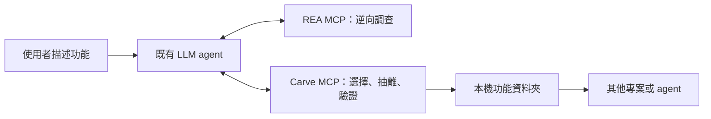

# Carve

**把逆向調查的功能，整理成 AI 可以直接重用的本機功能。**

Carve 是 **REA 的獨立附加 MCP**。LLM 分別呼叫 REA MCP 調查軟體，使用 Carve MCP 選擇功能、界定範圍、抽離或重建、比較行為，最後存成本機功能資料夾。REA 與 Carve 各自啟動，各自保有工具與身份。

**0.38.1 本機 alpha，尚未發佈 npm。** [English](README.md) · [雙 MCP 接法與乾淨安裝實測](docs/REA_COMPANION.md)

## 解決什麼問題

看懂一個功能後，還需要確認它依賴哪些模組、如何獨立使用，以及重建後是否符合預期。Carve 把這些工作整理成可交付的成果：

- **功能選單**：列出有來源線索的候選；都不符合時，接受使用者自己的描述。
- **抽離邊界**：記下選中的程式碼、證據與依賴；伺服器或平台未知項目保持明確。
- **行為驗證**：用具名案例比較原始操作或明確範圍的參考；多個候選、失敗和未驗證行為都保留。
- **功能重用**：輸出程式、來源紀錄、比較結果與 SKILL.md；之後讓 LLM 找到它，直接 import 或 invoke。



LLM 協調兩個獨立連線。Carve MCP 不包裝、代理或啟動 REA，也不新增把兩者合併的 MCP。既有 Carve Ghidra／JADX 工具保留相容性，不代表把 REA 引擎納入 Carve。

## 接到現有 agent

需要 Node22.19（22系列）或 Node24.11以上。在這份Carve原始碼目錄執行：

```sh
npm ci
npm run build
```

保留兩個 MCP 設定項目，絕對路徑換成實際位置：

```json
{
  "mcpServers": {
    "rea": {
      "command": "npx",
      "args": ["-y", "rea-agents@6.7.0", "mcp"]
    },
    "carve": {
      "command": "node",
      "args": ["/absolute/path/to/carve/dist/cli.js", "serve", "--root", "/absolute/path/to/workspace"]
    }
  }
}
```

REA 另外安裝，Carve 在本機建置。root 必須包含 Carve 要讀取的軟體、Evidence JSON 和輸出位置。Carve 不需要網站、網域、API服務或每個功能分別安裝，也不會由這份範例自動修改全域設定。[完整接法](docs/REA_COMPANION.md)

## 使用者怎麼用

可以直接對既有 agent 說：

> 用 REA 調查這個軟體，再用 Carve 列出可能抽離的功能，附上來源線索和未知依賴。沒有合適選項時讓我自行描述。選定後確認範圍，抽出或重建，以具體案例驗證，存成下次能重用的功能資料夾。

已知道功能時，補上「在哪裡觸發、給什麼輸入、希望得到什麼輸出」，agent 仍需確認實際程式碼與依賴。

CLI 也能先看候選，不必知道函式名稱：

```sh
node dist/cli.js reverse /path/to/software --out ./work
node dist/cli.js features ./work
node dist/cli.js features ./work --choice image --facet transform
```

不提供 goal 時，索引完成後回傳 `awaiting-feature-choice`。選擇候選或自訂描述後，再用 `reverse --goal` 建立該目標的穩定任務。[候選選單](docs/FEATURE_MENU.md)目前依據有界的路徑／名稱規則，不是內建 LLM，也不保證可抽離。未完成索引、掃描分頁與無命中都有明確狀態。

選定「圖片處理」後，可再區分變換、載入及快取。agent 用 `carve_scope` 保存觸發操作、輸入／輸出、是否有連續狀態，以及介面／遠端／系統需求；缺少的回答留成追問，下次可用記錄 ID 接續。這些是需求與來源線索，完整程式碼、依賴和行為仍需調查。[需求追問與接續方式](docs/FEATURE_SCOPE.md)

來源與輸出目標分開指定：同一個功能可規劃成Windows模組、Mac App、瀏覽器模組或服務。scope的optional target只記錄目的，`targetAssessment:not-performed`保留。完整專案可用 `project-plan`／`carve_project_plan` 讀取agent撰寫的功能依賴圖，檢查循環與開發順序；尚未自動發現所有功能、派工或整合App。[目標規格](docs/FEATURE_SCOPE.md#output-target) · [專案規劃](docs/PROJECT_PLAN.md)

選定功能後，以 `work-package create PLAN SPEC --feature parser --out 新資料夾` 準備完整輸入／輸出／狀態／錯誤介面、指定檔案範圍與驗收要求；agent開工前用 `work-package check 資料夾 --plan PLAN --spec SPEC` 拒絕過期交接。既有agent負責實作，Carve不啟動agent。[工作包與可直接試用的範例](docs/WORK_PACKAGES.md)

以 `work-ledger` 協調既有worker：原子認領、持久attempt、明確重試、提案／實際檔案交接與退回重做；舊attempt或介面版本不合就拒絕交件。檢查紀錄保持agent報告，待獨立驗證。[任務協作](docs/WORK_LEDGER.md)

Windows PE可用 `platform dependencies`／`platform adapters` 或 `carve_platform` 查來源import分類與目標adapter指引；結果指出需要調查的邊界，尚未實作或驗證移植。[平台分析](docs/PLATFORM_ANALYSIS.md)

## 交付成果

| 輸入與功能範圍 | 成果 |
| --- | --- |
| 支援的 JavaScript／ASAR 宣告閉包 | 原函式及所需來源依賴 |
| 有完整程式碼證據的編譯後操作 | agent 重建實作、來源紀錄及範圍明確的比較 |
| 已檢查的套件 | index.mjs、metadata、SKILL.md與比較紀錄組成的功能資料夾 |
| 缺失的伺服器、硬體或未解析依賴 | 明確列出的未知或未完成邊界 |

用 `carve_library_add` 存入本機功能庫；下次 `carve_library_find`、`carve_library_get`，再 import 或 `carve_invoke`。不必做成獨立程式。[功能庫](docs/LIBRARY.md)

JS／ASAR Evidence可保存實際回傳JSON，交給Carve核對模組／封裝檔位元組。原生Ghidra的指定完整紀錄可保存相同selector的procedure_pseudo_code與procedure_info，交給carve_import_rea_native；核對來源、語意ID、分析設定與函式範圍後，保存owned snapshot及原producer身分。選用的procedure_callees／outgoing procedure_references可保留呼叫位置、缺少的helper與未解析callback；trace／context只接相同REA分析設定。Carve MCP不會啟動REA。[原生交接](docs/REA_NATIVE.md) · [雙MCP設定](docs/REA_COMPANION.md)

## 已做過的實測

- **獨立 REA 原生交接**：真實REA／Ghidra偽碼與函式紀錄，在REA關閉後由Carve匯入、重建，比對160組原始native CLI案例，再獨立重用。關係交接案例另綁定3份完整code、追查2個直接helper，並通過160組原CLI比較；未解析callback與外部thunk仍明列未知，不宣稱依賴閉包完成。[重現方式](docs/REA_NATIVE.md)
- **REA 跨image交接**：核對原始call指令、stub／library ordinal、local載入路徑與defined export，綁定兩份獨立分析的函式；162組原始CLI比較及功能資料夾重用通過，拒絕另一條路徑的同名decoy。runtime／ABI／環境閉包仍未知。[跨image流程](docs/REA_BRIDGE.md)
- **分開分析的大型元件**：caller與library可保留各自索引與REA快照。跨工作區bridge重新核對兩側來源，端點必須由契約列出且獲路徑授權；相鄰工作區一起搬移後，可明確relocate並沿用原證據。全新獨立REA案例通過162組原CLI比較，拒絕錯誤路徑的同名library。[流程與限制](docs/REA_BRIDGE.md#cross-workspace-handoff)
- **有狀態操作序列**：每組序列使用一個原始程序與一個候選模組實例。自有原生計數／復原案例32組、635步通過，錯誤的每次重置實作被拒絕；完整序列可存進功能庫重用。不同請求仍重新開始。[使用與重現](docs/STATEFUL.md)
- **第三方狀態功能**：原 JDK Adler32物件31組序列、405步通過，結合完整Java類別與獨立REA原生證據，涵蓋初始化／分段更新／空資料／重置及功能庫重用。執行時類別雜湊與分析的模組映像位元組一致，參考仍明示為外部呼叫adapter。[證據與重現](docs/JDK_STATEFUL.md)
- **原始 Android 物件狀態**：ZXing 已發佈 APK 的 BitArray 在 Android15／API35 ARM64 ART 通過33組序列、692步；clear保留長度、new明確重建物件，錯誤的每步重置實作被拒絕。原DEX保留，功能資料夾可直接import／CLI／兩次全新MCP請求重用。使用既有managed後端，沒有啟動或代理REA。[範圍與重現](docs/ZXING_STATEFUL.md)
- **真實 Android JNI**：Termux 原版 DEX → native getZip → ART，比對80個metadata查詢、涵蓋3490筆ZIP項目，輸出可重用的metadata功能庫。[範圍與證據](docs/TERMUX_BOOTSTRAP.md)
- **跨模組案例**：自有 stripped 主程式與函式庫，162組原始CLI比較，獨立輸出可重用。[多元件契約](docs/MULTI_ARTIFACT.md)

## 開發與驗證

```sh
npm test
npm run verify:project-intent
npm run verify:feature-scope
npm run verify:rea-native -- --engines ./artifacts/engines/config.json
npm run verify:rea-relationships -- --engines ./artifacts/engines/config.json
npm run verify:rea-bridge -- --engines ./artifacts/engines/config.json
npm run check
```

原生REA檢查預設會在新建artifacts目錄安裝固定版本，以兩個獨立MCP驗證指定的自建原生程式功能，不代表所有REA provider已相容。

其他文件：[原生追查](docs/NATIVE.md)、[Android](docs/ANDROID.md)、[JNI](docs/JNI.md)、[引擎資源](docs/ENGINE_RESOURCES.md)、[可恢復佇列](docs/QUEUE.md)、[精簡上下文](docs/CONTEXT.md)、[驗證報告分頁](docs/VERIFICATION.md)、[完整重建流程](docs/RECONSTRUCTION.md)。

## 目前限制

Carve 提供工具與保存紀錄，推理和重建仍由既有 agent 主導。選單目前支援十類明確規則及自訂文字命中；名稱或圖譜線索不等於功能語意。原生／行動全自動抽離、任意外部Evidence匯入、複雜狀態／OS依賴、缺失伺服器邏輯與一般等價證明仍未完成。每份比較只涵蓋指定案例與參考範圍。

功能保留來源與適用授權通知；產物預設UNLICENSED，直到適用權利明確。Carve的MIT授權不會替輸入軟體重新授權。開發維持本機，尚無npm發佈版本。

書寫規範：專案內容使用英文，繁體中文 README 為唯一翻譯文件。見 [Contributing](CONTRIBUTING.md)。
