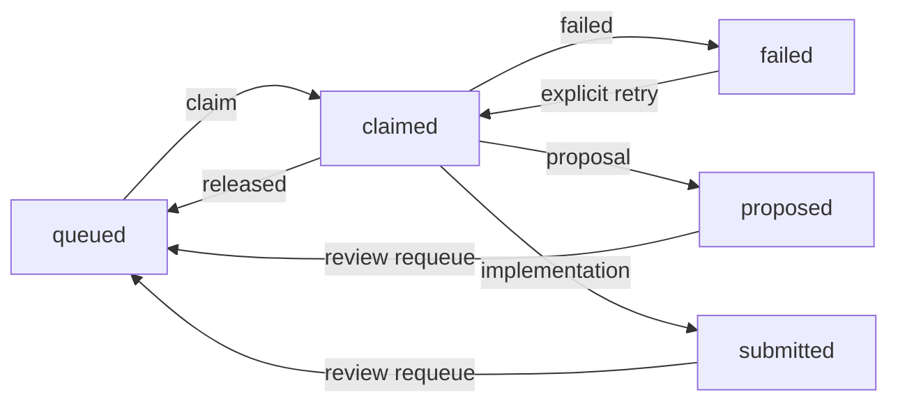

# Persistent claims, retries and submissions

`work-ledger` registers [work packages](WORK_PACKAGES.md) in local SQLite. Claims, failures, retries, proposals and submissions survive CLI/MCP restarts. Carve does not launch workers or mark submissions accepted/merged.

```sh
node dist/cli.js work-ledger create ./jobs
node dist/cli.js work-ledger register ./jobs --package ./parser-task --plan examples/work-plan.json --spec examples/work-spec.json
node dist/cli.js work-ledger claim ./jobs --id PACKAGE_SHA256 --owner worker --plan examples/work-plan.json --spec examples/work-spec.json > ./claim.json
node dist/cli.js work-ledger read ./jobs
```

Use registration's job.id, not taskId. The ledger folder must be new with an existing parent. Use the returned canonical path; symlink aliases and case/normalization aliases are refused with distinct diagnostics. Save id/owner/attempt/claimId from the claim reply. CLI --claim accepts the complete reply or those four fields.

First registration pins planId/specId. Register/claim/submit/requeue recheck the supplied current plan/spec and package; historical reads do not. Changed plans require new packages/ledgers.

## State machine



Short SQLite transactions choose one concurrent claimant. Each claim has a new attempt/claimId; stale workers cannot release or submit another claim. There is no timeout, PID inference or automatic takeover. Confirm an external worker stopped editing before explicit close. Owner/reviewer are declared labels, not authentication; claim IDs do not provide file isolation.

Released returns queued without consuming a work attempt. Failed requires retry=true next time. Reasons persist. Proposed/submitted require exact latest attempt/submissionId and reviewer/reason to requeue; history remains immutable. SQLite hot-journal recovery does not release workers. Reads may perform SQLite recovery writes, so the MCP tool is not read-only.

Limits: 500 jobs, 100 work attempts per job (failed/proposed/submitted), 1000 total claims per job including releases,128MiB database. Job cards include workAttempts and claimability: available, needs-explicit-retry, held, awaiting-review, exhausted. Exhaustion requires a new ledger while retaining history. Partial creation is preserved; missing valid ledger.json is not successful creation.

## Delivering files

Example submission.json:

```json
{"kind":"implementation","summary":"Implement the pinned parser; original comparison and integration remain pending.","checks":[{"name":"Original comparison","status":"not-run","detail":"No executable original reference available."}],"unknowns":["Target UI integration is unverified."]}
```

```sh
node dist/cli.js work-ledger submit ./jobs --claim ./claim.json --plan examples/work-plan.json --spec examples/work-spec.json --submission ./submission.json --output-root ./output
node dist/cli.js work-ledger read ./jobs --view attempts --id PACKAGE_SHA256
node dist/cli.js work-ledger read ./jobs --view result --id PACKAGE_SHA256 --attempt 1
node dist/cli.js work-ledger requeue ./jobs --id PACKAGE_SHA256 --attempt 1 --submission-id SUBMISSION_SHA256 --reviewer reviewer --reason 'Add boundary cases' --plan examples/work-plan.json --spec examples/work-spec.json
```

Implementation requires every assigned regular file below outputRoot, without symlink redirection. Each file is hashed: <=16MiB each/64MiB total. Files are not locked/copied atomically; rehash before acceptance/integration. Proposal must omit outputRoot and has no implementation artifacts.

Checks (<=32; passed/failed/not-run) and unknowns (<=64) are worker reports, not executed/authenticated acceptance. Whole result <=128KiB. Replies retain verification:not-run-by-ledger and integration:not-accepted-or-merged. Failed/not-run checks may be submitted honestly. Only the latest proposed/submitted result may be requeued; this cannot steal a claimed task or prove review was performed.

## MCP and bounded reads

`carve_work_ledger({ledger,request,budgetBytes?})` uses strict per-action fields:

| action | request fields |
| --- | --- |
| create | action |
| register | action, package, plan, spec |
| claim | action, id, owner, plan, spec, optional retry |
| close | action, claim, outcome, reason |
| submit | action, claim, plan, spec, submission path, implementation outputRoot |
| requeue | action, id, attempt, submissionId, reviewer, reason, plan, spec |
| read | action, optional view/id/status/attempt/offset/limit/characters |

For MCP claim objects, extract four identifiers from job in the CLI reply. Inputs, packages, database sidecars and outputs are root-confined; data text grants no permissions.

Jobs filter by id/status; attempts requires id; result requires id+attempt. Lists use offset/limit1–100; result text uses UTF-16 offset/characters1–12000 without splitting surrogate pairs. Budget1024–65536 measures exact compact UTF-8 bytes. State changes increment revision; restart paginated reads if revision changes. Offset is not a snapshot.

Response budget is checked before commit; failures roll back. If the external connection drops after commit, read state before retrying. Historical read explicitly returns currentPlanCheck:not-performed.

`npm run verify:work-ledger` tests independent MCP competition/reconnect, older package compatibility, retries, proposal/requeue/implementation, stale rejection. [Platform guidance](PLATFORM_ANALYSIS.md) is separate static evidence, not proof of App reconstruction.
